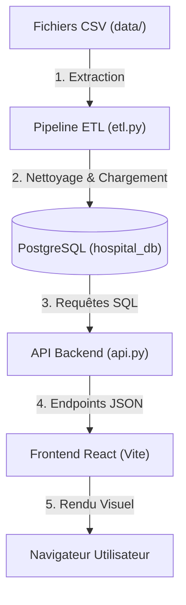

# Plan d'implémentation — Revue de Code, Sécurisation et DevOps

Ce plan d'implémentation détaille les modifications de code et les configurations DevOps proposées pour stabiliser, sécuriser et préparer le projet pour la production.

## Résumé du Projet & Flux de Données

Le projet est un **Hospital Data Warehouse (DWH)**. Il se compose de 4 grandes briques :
1. **Base de données (PostgreSQL)** : Stocke les dimensions (`dim_patients`, `dim_doctors`) et les faits (`fact_appointments`, `fact_treatments`, `fact_billing`).
2. **Pipeline ETL (Python/Pandas)** : Lit les fichiers CSV bruts, nettoie et formate les lignes (dates, montants négatifs, doublons, données manquantes) et les charge dans la base.
3. **API Backend (FastAPI)** : Expose des points d'accès (endpoints) pour interroger la base et renvoyer des métriques agrégées (KPIs, revenus mensuels, etc.).
4. **Frontend (Vite/React)** : Dashboard interactif qui appelle l'API pour dessiner les graphiques Recharts et les tableaux de bord.

---

## Modifications Proposées

### 1. Robustesse DevOps & Dockerisation

#### [MODIFY] [Dockerfile (Frontend)](file:///c:/Users/Mohamed/Desktop/hospital-data-warehouse/frontend/Dockerfile) (Remplacement complet)
Actuellement, le Dockerfile du frontend est une copie du Dockerfile de l'API Python. Nous allons le réécrire avec un build multi-étape propre :
*   **Étape 1 (Build)** : Utilise `node:20-alpine` pour compiler l'application React avec Vite.
*   **Étape 2 (Production)** : Utilise `nginx:alpine` pour servir les fichiers statiques HTML/JS de façon très performante.

#### [MODIFY] [docker-compose.yml](file:///c:/Users/Mohamed/Desktop/hospital-data-warehouse/docker-compose.yml)
*   Ajout du service `frontend` connecté au réseau `hospital_network`.
*   Paramétrisation des identifiants PostgreSQL (utilisation de variables d'environnement au lieu de secrets hardcodés).
*   Changement des ports par défaut pour éviter les conflits locaux.

#### [NEW] [ci-cd.yml](file:///c:/Users/Mohamed/Desktop/hospital-data-warehouse/.github/workflows/ci-cd.yml)
Création d'un pipeline de CI/CD GitHub Actions pour automatiser :
1. Le linting et les tests du code.
2. Le build des images Docker pour le backend et le frontend.
3. La simulation du déploiement.

---

### 2. Sécurisation & Idempotence (Backend/ETL)

#### [MODIFY] [etl.py](file:///c:/Users/Mohamed/Desktop/hospital-data-warehouse/etl/etl.py)
*   **Problème** : Si le script ETL est exécuté deux fois, il plante à cause d'erreurs de clé primaire dupliquée (`UniqueViolation`) car il fait un simple `append`.
*   **Correction** : Ajout d'une étape de nettoyage / troncature des tables dans le bon ordre (faits d'abord, puis dimensions) avant d'insérer les nouvelles données. Cela rend l'ETL **idempotent** (exécutable à l'infini sans erreur).

#### [MODIFY] [api.py](file:///c:/Users/Mohamed/Desktop/hospital-data-warehouse/etl/api.py)
*   Ajout de la configuration du Pool de Connexion (`pool_size`, `max_overflow`, `pool_pre_ping`) pour éviter d'épuiser les connexions Postgres en production.
*   Sécurisation des requêtes en s'assurant que les futurs paramètres soient passés de manière sécurisée (requêtes préparées) plutôt que par concaténation de chaînes.

---

## Plan de Vérification

### Tests Automatiques
*   Exécution de `docker compose build` pour s'assurer que toutes les images (y compris le nouveau frontend Nginx) se construisent correctement.
*   Lancement de `docker compose up` pour valider que l'ETL s'exécute avec succès, s'arrête proprement, et que l'API et le Frontend deviennent accessibles.

### Manuel Verification
*   Re-exécuter `docker compose up` une seconde fois pour vérifier l'idempotence de l'ETL (pas de plantage de clé dupliquée).
*   Se connecter à `http://localhost:8080` (nouveau port frontend de prod) et vérifier que le dashboard affiche bien toutes les données.
